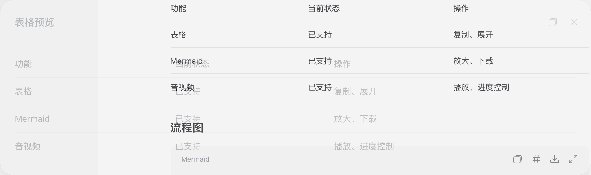
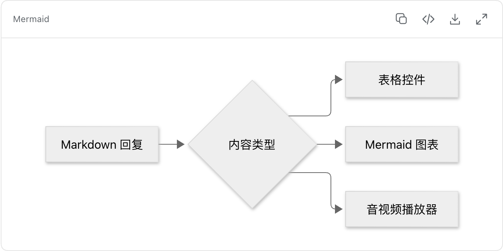
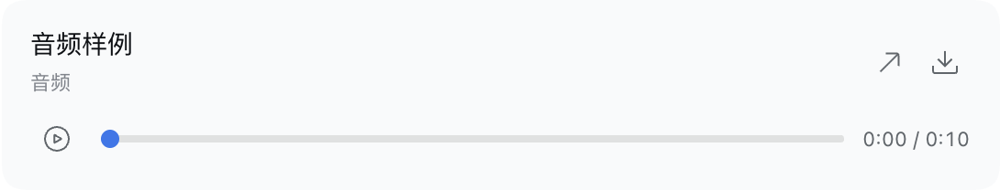
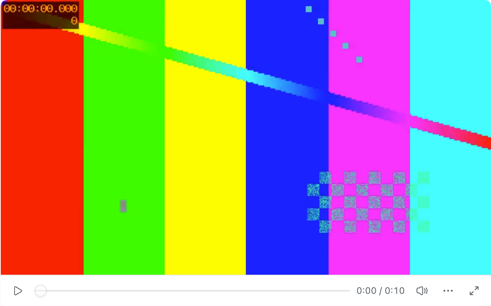
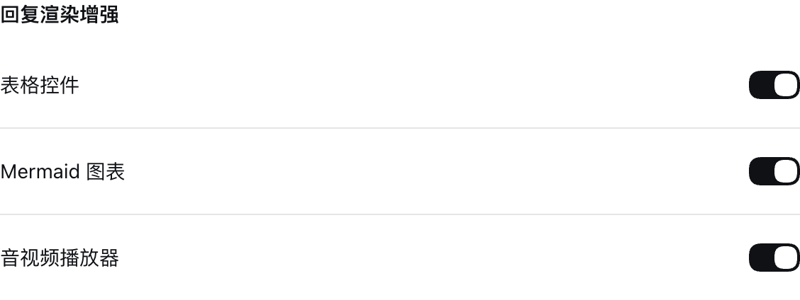

# DSH Codex Renderer

为 DeepSeek Harness 增加表格、Mermaid 图表与音视频播放器，结合 Codex 的操作方式和 DSH 原生组件样式。

## 功能

| 组件 | 功能 |
| --- | --- |
| 表格 | 悬停工具栏、复制表格、展开预览、保留横向滚动 |
| Mermaid | 图表渲染、源码切换、源码复制、SVG 下载、预览缩放 |
| 音频 | 播放与暂停、时间轴定位、进度显示、文件下载 |
| 视频 | 内嵌播放、进度控制、浏览器全屏、文件下载 |

### 表格

鼠标悬停在表格上时显示操作按钮。复制内容同时包含纯文本与 HTML 表格，便于粘贴到文档或电子表格中。


展开后，可以在独立窗口中阅读表格。



### Mermaid 图表

自动识别 `mermaid` 代码块并生成图表。支持切换源码、复制源码、下载 SVG 和放大预览。



### 音视频

自动识别回复中的音视频文件，显示内嵌播放器。





## 安装

要求 DeepSeek Harness **0.2.0-rc.2 或更新版本**，构建环境使用 Node.js **22.19.0 或更新版本**。

在项目目录中构建安装包：

```sh
npm ci
npm run build
npm pack
```

安装到桌面端：

```sh
dsh plugin --profile desktop add "$PWD/deepseekharness-plugin-dsh-codex-renderer-0.1.3.tgz"
```

然后在 DSH 的「插件」页面确认「回复渲染增强」已启用。

## 设置

在「设置 → 通用设置」中，分别开启或关闭「表格控件」「Mermaid 图表」和「音视频播放器」。这三项使用 DSH 原生开关与默认设置行布局。



三个功能默认开启。关闭某项后，现有回复会恢复 DSH 原有显示方式。

## 使用示例

表格使用标准 Markdown 表格语法。Mermaid 使用带语言标记的代码块：

````markdown

````

音视频可以通过图片语法或独立文件链接展示：

```markdown


```

支持绝对本地路径与 HTTP(S) 地址。音视频格式由 DSH 使用的浏览器内核解码。

## 开发与验证

```sh
npm run check
```

测试覆盖 Markdown 内容识别、表格剪贴板格式、预览开关、Mermaid 渲染及错误状态、媒体播放与定位，以及插件连续启停。宿主测试在隔离配置中启动本机 DSH，通过本地模拟模型返回样例。

若相邻目录存在已构建的 `dsh-codex-annotations`，还会验证两种插件加载顺序下的冷启动、选区批注、保存引用与刷新恢复。测试使用的音视频文件随仓库提供。

图表使用 [Mermaid](https://mermaid.js.org/)，Markdown 内容识别使用 [mdast-util-from-markdown](https://github.com/syntax-tree/mdast-util-from-markdown)。依赖随插件打包，无需加载外部 CDN。第三方许可证随构建产物保存在 `lib/THIRD_PARTY_LICENSES.txt`。

## License

[MIT](LICENSE)
