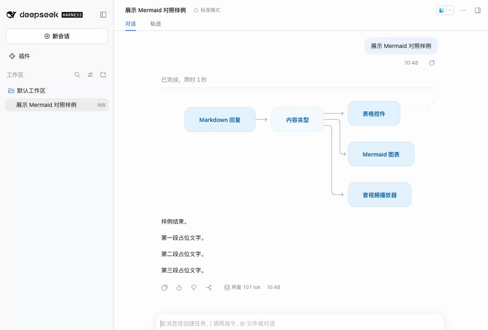
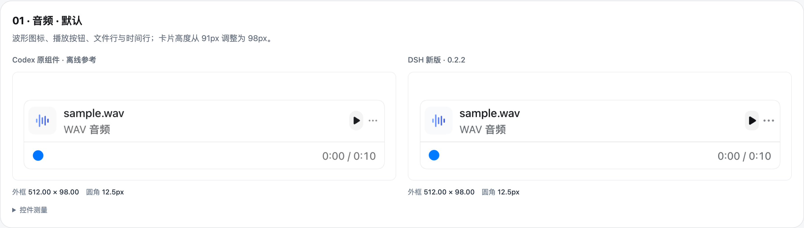

# DSH Codex Renderer

为 DeepSeek Harness 增加表格、Mermaid 图表与音视频播放器，表格沿用 DSH 原生样式，Mermaid 与音视频参照 Codex 桌面端的控件布局实现。

## 功能

| 组件 | 功能 |
| --- | --- |
| 表格 | 悬停工具栏、复制表格、展开预览、保留横向滚动 |
| Mermaid | 圆角节点、虚线判断框、悬停菜单、PNG 导出、展开缩放与拖动 |
| 音频 | 播放与暂停、时间轴定位、进度显示、文件下载 |
| 视频 | 自定义播放条、定位、音量、倍速、全屏、画中画 |

### 表格

鼠标悬停在表格上时，表头右侧显示复制与展开按钮。复制内容同时包含纯文本与 HTML 表格，便于粘贴到文档或电子表格中。


展开后，可以在按内容取宽的预览窗口中阅读表格，保留 DSH 原有的字号、链接与表格样式。


### Mermaid 图表

自动识别 `mermaid` 代码块。流程图采用 ELK 布局、60px 圆角节点、虚线判断框与细折线，支持浅色和深色外观。

悬停时显示「图表选项」和「展开图表」。菜单提供源码切换、原始源码复制和两倍分辨率 PNG 下载。展开预览使用 DSH 原生弹窗的遮罩、标题栏和关闭按钮。弹窗内可以拖动图表、使用底部控件缩放，按 Esc 或点击遮罩关闭；缩放时窗口大小保持固定。




同一份源码的节点、菜单、预览、窄容器与深色外观，对照见 [Mermaid 校准记录](docs/codex-mermaid-parity.md)。

### 音视频

自动识别回复中的音视频文件。音频使用文件卡片、格式说明和独立时间轴；视频使用自定义操作条，支持音量、倍速、全屏与画中画。


## 安装

要求 DeepSeek Harness **0.2.0-rc.2 或更新版本**，构建环境使用 Node.js **22.19.0 或更新版本**。

在项目目录中构建安装包：

```sh
npm ci
npm run build
npm pack
```

安装到桌面端：

```sh
dsh plugin --profile desktop add "$PWD/deepseekharness-plugin-dsh-codex-renderer-0.3.1.tgz"
```

然后在 DSH 的「插件」页面确认「回复渲染增强」已启用。

## 设置

在「设置 → 通用设置」中，分别开启或关闭「表格控件」「Mermaid 图表」和「音视频播放器」。这三项使用 DSH 原生开关与默认设置行布局。


三个功能默认开启。关闭某项后，现有回复会恢复 DSH 原有显示方式。

## 使用示例

表格使用标准 Markdown 表格语法。Mermaid 使用带语言标记的代码块：

````markdown

````

音视频可以通过图片语法或独立文件链接展示：

```markdown


```

支持绝对本地路径与 HTTP(S) 地址。音视频格式由 DSH 使用的浏览器内核解码。

## 验证音视频

项目提供一段 10 秒测试音频和一段带声音的测试视频。在项目目录中运行：

```sh
npm run demo:media
```

把输出的提示词复制给 DSH，让助手原样回复其中的 Markdown。播放器出现后，可检查播放、暂停，并把进度拖到第 5 秒；视频应显示持续变化的画面。

播放器增强作用于助手回复。链接放在代码块中时会显示为代码，无法生成播放器。

## 音视频控件对齐

音频的附件行和视频操作条按 Codex 原组件的截图与尺寸实现，对比覆盖 20 个状态，包括播放、悬停、拖动、菜单、音量、全屏、窄宽度与深色模式。表格保持原有布局，设置仍使用 DSH 原生组件。



参考截图由本机 Codex 生产组件离线渲染，DSH 截图来自真实 Web 宿主。尺寸、截图来源和仍存在的差异见 [逐状态对照记录](docs/codex-media-parity.md)。

## 开发与验证

```sh
npm run check
```

测试覆盖 Markdown 内容识别、表格剪贴板格式、预览开关、Mermaid 渲染及错误状态、媒体播放与定位，以及插件连续启停。宿主测试在隔离配置中启动本机 DSH，通过本地模拟模型返回样例。

若相邻目录存在已构建的 `dsh-codex-annotations`，还会验证两种插件加载顺序下的冷启动、选区批注、保存引用与刷新恢复。测试使用的音视频文件随仓库提供。

图表使用 [Mermaid](https://mermaid.js.org/)，Markdown 内容识别使用 [mdast-util-from-markdown](https://github.com/syntax-tree/mdast-util-from-markdown)。依赖随插件打包，无需加载外部 CDN。第三方许可证随构建产物保存在 `lib/THIRD_PARTY_LICENSES.txt`。

## License

[MIT](LICENSE)
