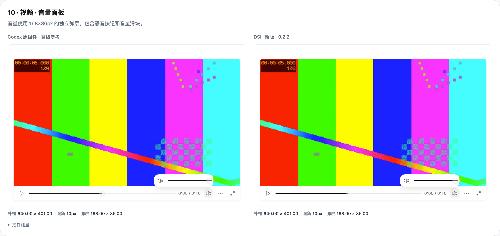

# Codex 音视频逐状态对照

2026-10-13 对照本机 Codex **26.1007.30912** 的生产音视频组件与 DSH **0.2.0-rc.2** 的插件回复。表格、表格预览和 Mermaid 保持原有实现。

参考组件直接读取本机 Codex 安装包，在隔离 Chrome 中离线渲染，保留原始组件逻辑、生产 CSS、中文文案、样式层顺序与 Electron 样式标记。没有重启或连接正在运行的 Codex，也没有把 Codex 的代码打包进本插件。

DSH 截图来自隔离配置的真实 Web 宿主。两侧使用同一份 10 秒 WAV 和 640×360 MP4，显示比例为 2 倍。数值为 CSS 像素；截图中的媒体帧可能相差几个解码帧。

## 逐状态检查

共比较 20 个状态：音频默认、悬停、播放、定位、文件菜单；视频默认、悬停、定位、按住滑块、音量、速度菜单、速度选中、全屏、300px 容器、播放、键盘焦点、静音、菜单悬停；音频和视频深色模式。

| 节点 | Codex 实测 | 0.2.1 | 0.2.2 |
| --- | --- | --- | --- |
| 音频卡片 | 512×98 | 514×91 | 512×98 |
| 文件标题 / 格式 | 16px / 15px，行高 24px / 22.5px | 16px / 14px，行高均为 20px | 同参考字号和行高 |
| 音频播放按钮 | 20×28、无描边、圆角背景 | 28×28、方形描边 | 20×28、无描边、圆角背景 |
| 音频菜单 | 160×65.13，两项操作 | 234×106，三项操作 | 160×65.16，复制路径与保存副本 |
| 640×360 视频 | 640×401 | 680×431.5 | 640×401 |
| 视频操作条 | 40px 控件加 1px 分隔线 | 额外上下内边距 | 40px 控件加 1px 分隔线 |
| 音量弹层 | 168×36 | 234×54 | 168×36 |
| 速度菜单 | 112.59×366.75 | 234×430 | 112.59×366.36 |
| 300px 视频容器 | 300×229.75，进度条独占首行 | 按视口宽度换行 | 300×229.75，按容器宽度换行 |

圆角随浏览器的 `corner-shape` 支持调整：普通模式音频 10px、视频 8px、菜单 16px；支持超椭圆时分别为 12.5px、10px、20px，与参考的规则一致。

### 音频

左侧是生产组件离线参考，右侧是插件在 DSH 宿主中的呈现。波形图标、文件行、格式行、进度和按钮均独立实现。

### 视频音量

两侧音量面板均为 168×36。菜单按实测内容尺寸定位，不再使用预设 300px 高度估算位置。

## 交互与差异

- 视频按住时间轴时暂停，松开后恢复此前的播放状态；键盘定位只在滑块上显示焦点环。
- 视频菜单位于控制条上方，音频菜单位于按钮下方，空间不足时翻转。全屏时弹层进入全屏容器。
- 音频按钮采用背景反馈；视频按钮保留延迟提示框。鼠标形态按参考的 macOS 默认箭头处理。
- 文件操作使用 DSH 提供的真实路径和文件接口。当前 Codex 中文包的 `Copy link` 文案缺少翻译，插件使用“复制链接”。

几何尺寸与状态反馈已按截图修正。颜色继续采用 DSH 主题变量，深色操作条比 Codex 更亮；图标由插件独立绘制，仍可能有细微轮廓差异。此次截图是原组件的离线渲染，桌面窗口材质与平台控件尚未逐状态核验。

## 验证

`npm run check` 通过 4 项内容与设置测试、20 项真实 DSH 宿主检查和 2 种插件加载顺序的冷启动检查。覆盖播放、定位、倍速、音量、静音、全屏菜单、尺寸、路径复制、HTTP 与本地文件、表格、图表及批注兼容性。
