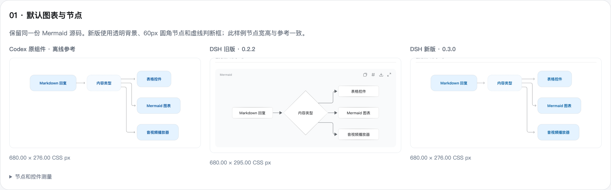
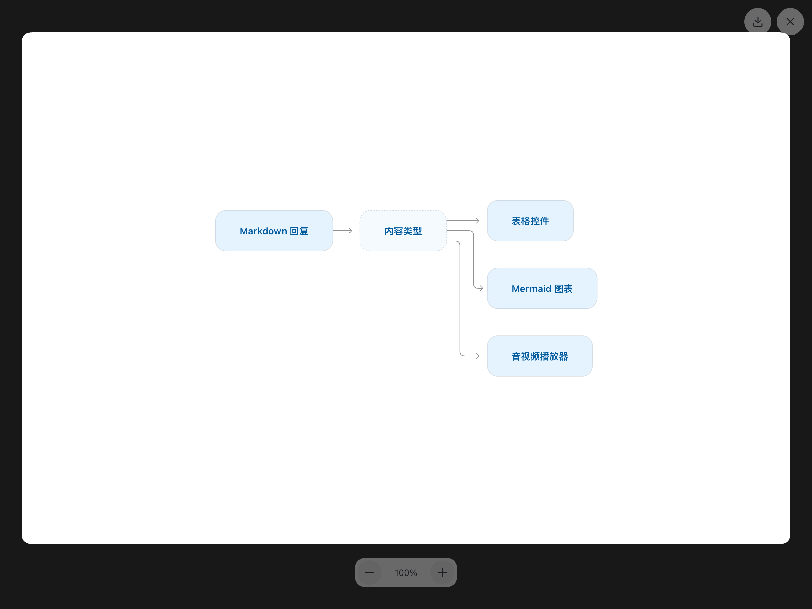

# Mermaid 控件校准

更新版本：0.3.0，校验日期：2026-10-14。

旧版使用普通 Mermaid 节点与 DSH 代码卡片，判断框、字重、连线、操作入口和展开预览都与 Codex 有明显差异。新版为流程图增加独立布局适配，并重新实现图表操作和查看器。

## 参考与截图来源

Codex 参考来自本机 26.1007.30912 安装包的生产 Mermaid 组件，使用实际组件和样式在隔离 Chrome 中离线渲染，指定默认聊天配色。没有停止或重启 Codex。DSH 截图来自本机 0.2.0-rc.2 的真实 Web 宿主，使用隔离配置和本地模拟模型返回同一份源码。

对照覆盖默认图表、悬停、选项菜单、展开、125% 缩放、340px 窄容器和深色模式。参考截图中源码编辑器由 Codex 宿主提供，本次只核对其菜单入口；插件使用行内源码切换。

## 测量结果

以 README 的五节点流程图为基准，单位为 CSS px：

| 项目 | Codex 参考 | 旧版 0.2.2 | 新版 0.3.0 |
| --- | --- | --- | --- |
| 行内容器 | 680×276，透明背景 | 680×295，灰色标题卡片 | 680×276，透明背景 |
| Markdown 回复节点 | 173.86×60 | 约 152×41 | 173.86×60 |
| 内容类型判断框 | 128×60，虚线圆角框 | 167×167，菱形 | 128×60，虚线圆角框 |
| 表格控件节点 | 128×60 | 152×41 | 128×60 |
| Mermaid 图表节点 | 162.89×60 | 152×41 | 162.89×60 |
| 音视频播放器节点 | 156×60 | 152×41 | 156×60 |
| 节点字号与字重 | 14px / 600 | 14px / 400 | 14px / 600 |
| 操作按钮 | 2 个 36px 圆形按钮，悬停出现 | 4 个 28px 常驻按钮 | 2 个 36px 圆形按钮，悬停出现 |
| 窄容器 | 340×240 | 340×192 | 340×240 |
| 展开窗口 | 1200×900 | 960×357 | 1200×900 |
| 放大一次 | 125%，窗口不变 | 125%，窗口增高 | 125%，窗口不变 |

该样例的节点位置和 SVG 边界已对齐。不同 Mermaid/ELK 版本仍可能使复杂图的路由、短连接末端圆弧有少量差异。图表使用 DSH 字体和外观变量；菜单、预览的动画按插件实现，不代表逐帧复用 Codex。

## 实现与交互

- 通过 Mermaid 的公开 `registerLayoutLoaders` 接口包装官方 ELK 加载器，设置流程图节点尺寸与端口间距；保留分组、圆形等其他节点形状。
- 判断框使用虚线圆角样式，分支连线使用细线、圆角拐点和开放箭头。
- 图表选项提供「显示源代码」「复制为代码」「下载图像」。复制保留原始源码，图片按两倍分辨率导出 PNG。
- 展开查看器覆盖窗口，底部控制缩放，拖动平移；支持 Esc 关闭、焦点返回、打开和关闭动画，以及减少动态效果偏好。
- 绘制任务串行执行，避免多个图表与主题更新争用 Mermaid 的全局配置。

使用的 Mermaid 和 ELK 依赖均随插件打包，不加载外部 CDN。公开扩展接口见 [Mermaid 布局文档](https://mermaid.js.org/community/layout-makers-guide.html)。

## 验证

`npm run check` 通过：4 项单元测试、21 项真实宿主检查，以及与批注插件的两种加载顺序冷启动检查。宿主无页面异常。

检查覆盖节点尺寸、悬停菜单、原始源码复制、PNG 文件与尺寸、缩放时窗口固定、拖动、关闭动画与焦点、主题切换、时序图、分组、圆形节点、边标签、回路和连续启停清理。表格、音视频的既有交互检查同时通过。
